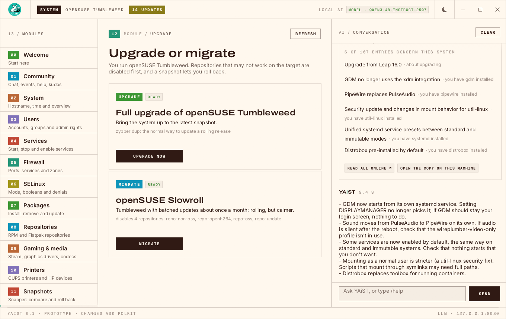
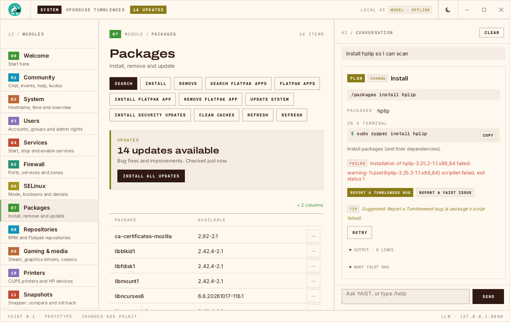

<p align="center">
  
</p>

# YAiST

A local, AI-assisted successor to YaST for openSUSE. Manage the system by
asking in plain language, by typing `/commands`, or in classic panels. All
three run the same actions, and every change waits for your confirmation.

- Runs on any openSUSE: Leap, Tumbleweed, Slowroll and the immutable variants
  (immutable Leap, Leap Micro, MicroOS, Aeon, Kalpa). Updates use `zypper up`,
  `zypper dup` or `transactional-update --continue` as fits; on immutable
  systems every change lands in one new snapshot, and YAiST shows when a
  reboot is needed to use it.
- The model runs locally (llama.cpp); nothing leaves the machine.
- Terminal UI and desktop GUI with the same layout.

Status: **prototype**.


## Examples

**Conflicts are questions, not failures.** Here zypper found three conflicts
in one install. Each comes up in turn with zypper's own solutions, and a
summary follows before anything is changed:


**What's new while you wait.** During an upgrade to a new Leap release,
YAiST offers to tell what changes. It shows the release-notes entries that
concern this system (hardware, desktop, installed packages), each a link,
and the local model sums them up:



**Reporting a problem, when you decide to.** A failed change offers a
prefilled openSUSE Bugzilla report or YAiST issue, the likelier one first,
with what was run and its output already in it:



**Familiar commands work too.** `zypper in fish`, `sudo systemctl restart
sshd` or `zypper --releasever 16.1 dup` typed in the prompt give the same
confirmation card as asking in plain language. Every card shows the terminal
command it stands for and, after a change, exactly what YAiST ran.

Try any of these without changing anything: type `/demo` in the prompt for
the made-up scenes, e.g. `/demo whats-new` or `/demo report-distro`.

## Modules

YAiST opens on a **welcome screen** that takes over from openSUSE-welcome:
starting points (updates, snapshot, software, users, firewall, new releases),
questions to try, the system at a glance and links into the community.

System (hostname, time zone, NTP), Users, Services (systemd), Firewall
(firewalld), SELinux, Packages and Repositories (zypper, OBS community
repositories and Flatpak remotes), Gaming & media (Steam, graphics drivers,
SELinux gaming policy, codecs), Printers (CUPS, driverless IPP, HP devices
through HPLIP, like YaST's printer module), Snapshots (snapper: compare, create, roll back) and Upgrade
(Tumbleweed/Slowroll: `zypper dup`; Leap: move to a newer release with the
repositories switched to it, like opensuse-migration-tool).

## Installing

Packages are built in the OBS project
[home:lkocman:YAiST](https://build.opensuse.org/project/show/home:lkocman:YAiST).
Add the repository for your distribution:

```sh
# openSUSE Tumbleweed
sudo zypper ar https://download.opensuse.org/repositories/home:/lkocman:/YAiST/openSUSE_Tumbleweed/home:lkocman:YAiST.repo
# openSUSE Slowroll
sudo zypper ar https://download.opensuse.org/repositories/home:/lkocman:/YAiST/openSUSE_Slowroll/home:lkocman:YAiST.repo
# openSUSE Leap 16.0
sudo zypper ar https://download.opensuse.org/repositories/home:/lkocman:/YAiST/16.0/home:lkocman:YAiST.repo
# openSUSE Leap 16.1
sudo zypper ar https://download.opensuse.org/repositories/home:/lkocman:/YAiST/16.1/home:lkocman:YAiST.repo
```

Then install it and start the local AI:

```sh
sudo zypper ref                           # trust the project's signing key when asked
sudo zypper in yaist-gui                  # desktop and terminal; yaist for the terminal only
sudo systemctl enable --now yaist-llm
yaist-gui                                 # or: yaist
```

`yaist` requires the local model, `yaist-offline`: Qwen3-4B with llama.cpp,
about 2.5 GB, nothing downloaded at run time. It runs as the sandboxed
`yaist-llm` service, which is not enabled on its own; until it runs, panels
and `/commands` work and the conversation says how to start it.

## More

- [docs/DEVELOPMENT.md](docs/DEVELOPMENT.md): running from source, the
  command line, privileges, configuration, demos and screenshots
- [PLAN.md](PLAN.md): the design
- [docs/LICENSING.md](docs/LICENSING.md): licensing

## License

Apache-2.0. Bundled fonts are OFL-1.1. Details in
[docs/LICENSING.md](docs/LICENSING.md), [NOTICE](NOTICE) and
[REUSE.toml](REUSE.toml).
