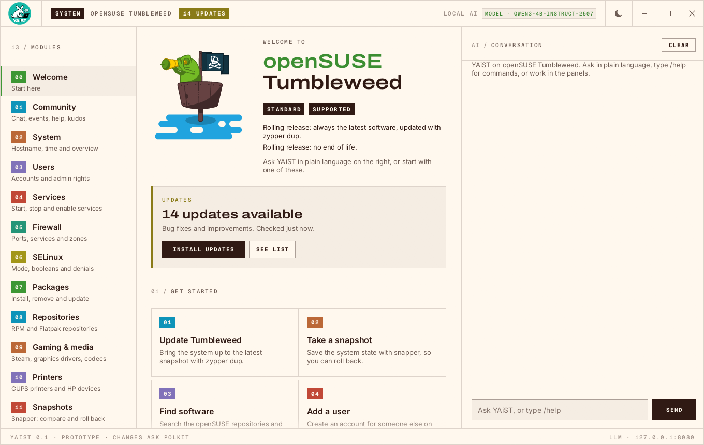
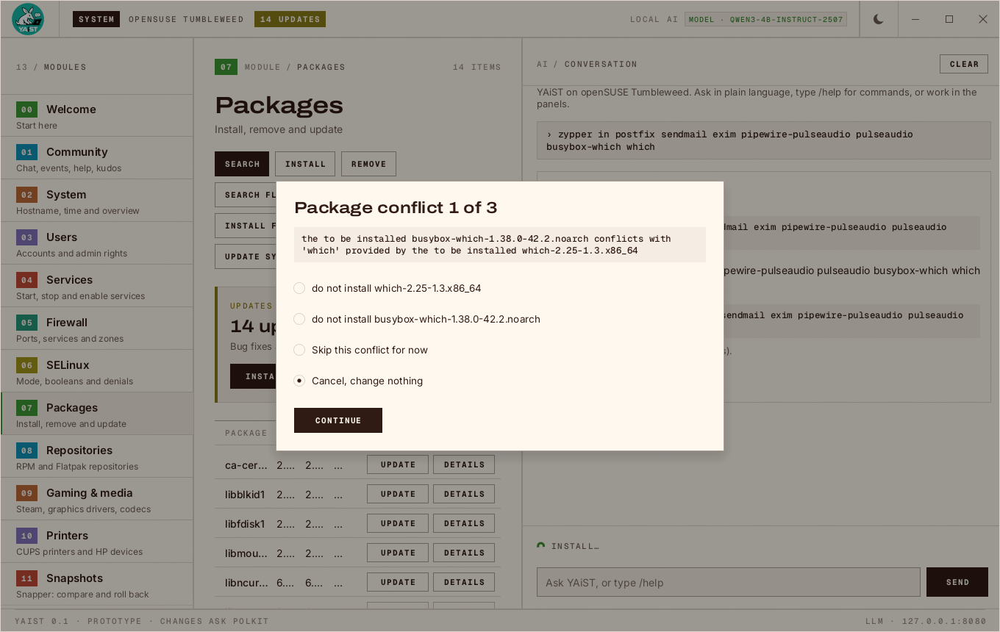

<p align="center">
  
</p>

# YAiST

A local, AI-assisted successor to YaST for openSUSE. Manage the system by
asking in plain language, by typing `/commands`, or in classic panels. All
three run the same actions, and every change waits for your confirmation.

- Runs on any openSUSE: Leap, Tumbleweed, Slowroll and the immutable variants
  (immutable Leap, Leap Micro, MicroOS, Aeon, Kalpa). Updates use `zypper up`,
  `zypper dup` or `transactional-update --continue` as fits; on immutable
  systems every change lands in one new snapshot, and YAiST shows when a
  reboot is needed to use it.
- The model runs locally (llama.cpp); nothing leaves the machine.
- Terminal UI and desktop GUI with the same layout.

Status: **prototype**. See [PLAN.md](PLAN.md) for the design and
[docs/LICENSING.md](docs/LICENSING.md) for licensing.



When a change runs into trouble, YAiST asks instead of failing. Here zypper
found three conflicts in one install; each comes up in turn with zypper's own
solutions, and a summary follows before anything is changed:



## Modules

YAiST opens on a **welcome screen** that takes over from openSUSE-welcome:
starting points (updates, snapshot, software, users, firewall, new releases),
questions to try, the system at a glance and links into the community.

System (hostname, time zone, NTP), Users, Services (systemd), Firewall
(firewalld), SELinux, Packages and Repositories (zypper, OBS community
repositories and Flatpak remotes), Gaming & media (Steam, graphics drivers,
SELinux gaming policy, codecs), Printers (CUPS, driverless IPP, HP devices
through HPLIP, like YaST's printer module), Snapshots (snapper: compare, create, roll back) and Upgrade
(Tumbleweed/Slowroll: `zypper dup`; Leap: move to a newer release with the
repositories switched to it, like opensuse-migration-tool).

## Running

```sh
# 1. The local model (rootless podman, Vulkan GPU if available; first start
#    downloads ~2.5 GB)
scripts/llm-server.sh

# 2. Build (needs cargo; without it, builds in a Leap 16.0 container)
cargo build                      # or: scripts/build-in-container.sh build

# 3. Use it
target/debug/yaist-gui           # desktop
target/debug/yaist               # terminal (ctrl-q quits)
```

Familiar commands work in the prompt too and show what they map to, so
`zypper in fish`, `sudo systemctl restart sshd` or `zypper --releasever 16.1
dup` give the same confirmation card as asking in plain language. Every plan
card shows the equivalent terminal command, and after a change, exactly what
YAiST executed.

To get YAiST into the desktop's app menu with its icon (development build,
no root): `scripts/dev-install-desktop.sh`.

Command line:

```sh
yaist run /firewall overview             # any read action
yaist run /firewall open-port 8080 --yes # changes need --yes
yaist ask "is ssh running?"              # one request through the agent; plans are never applied
yaist help [module]                      # all /commands
yaist tools                              # the tool definitions the model sees
```

Changes run with your privileges through polkit: systemd, firewalld and
timedated ask for authentication themselves; package, user and SELinux changes
use `pkexec`, and snapshots and Leap upgrades go through `yaist-helper`, a
small privileged program that re-validates its arguments. Plain pkexec asks
for the password every time; `scripts/dev-install-helper.sh` installs the
helper with a polkit policy that keeps the authorisation for a few minutes.
In the planned design all of this moves into a privileged `yaistd` daemon.

## Configuration

| Variable | Default |
|---|---|
| `YAIST_LLM_URL` | `http://127.0.0.1:8080` |
| `YAIST_WELCOME_ART` | an SVG or PNG shown on the welcome screen instead of the drawn chameleon (e.g. the openSUSE logo) |
| `YAIST_END_OF_LIFE` | pretend the end of support is this date (`YYYY-MM-DD`), to see the END OF LIFE state |
| `YAIST_OS_RELEASE` | pretend to be another flavour, e.g. `tests/os-release/leap-16.1-immutable` (development; check plans only) |
| `YAIST_MODEL` (llm-server.sh) | `unsloth/Qwen3-4B-Instruct-2507-GGUF:Q4_K_M` |
| `YAIST_LLM_PORT` (llm-server.sh) | `8080` |

## Layout

```
crates/yaist-core      action model: specs, validation, /command syntax, registry
crates/yaist-modules   system, users, services, firewall, selinux, packages, repos
crates/yaist-agent     llama-server client and tool-calling agent
crates/yaist-ui        shared client model (state, plans, forms, palette)
apps/yaist             TUI + CLI
apps/yaist-gui         egui desktop app
```

## License

Apache-2.0. Bundled fonts are OFL-1.1. Details in
[docs/LICENSING.md](docs/LICENSING.md), [NOTICE](NOTICE) and
[REUSE.toml](REUSE.toml).
